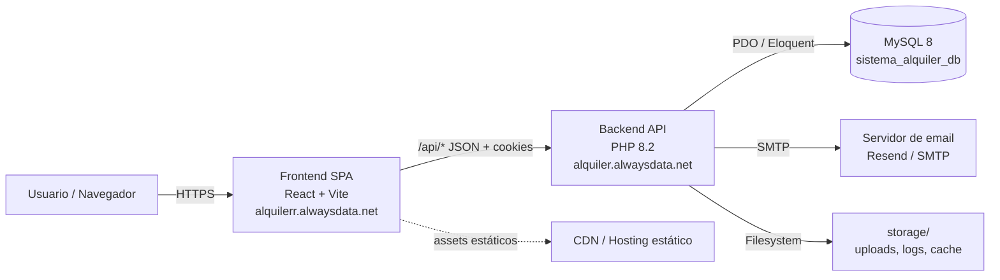
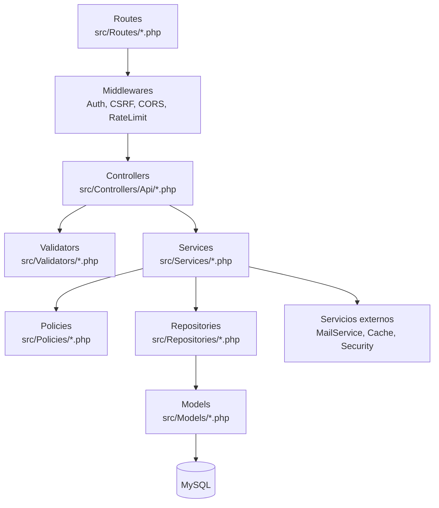
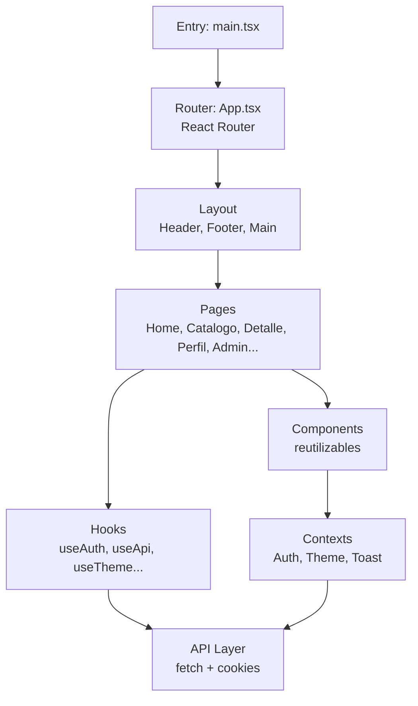
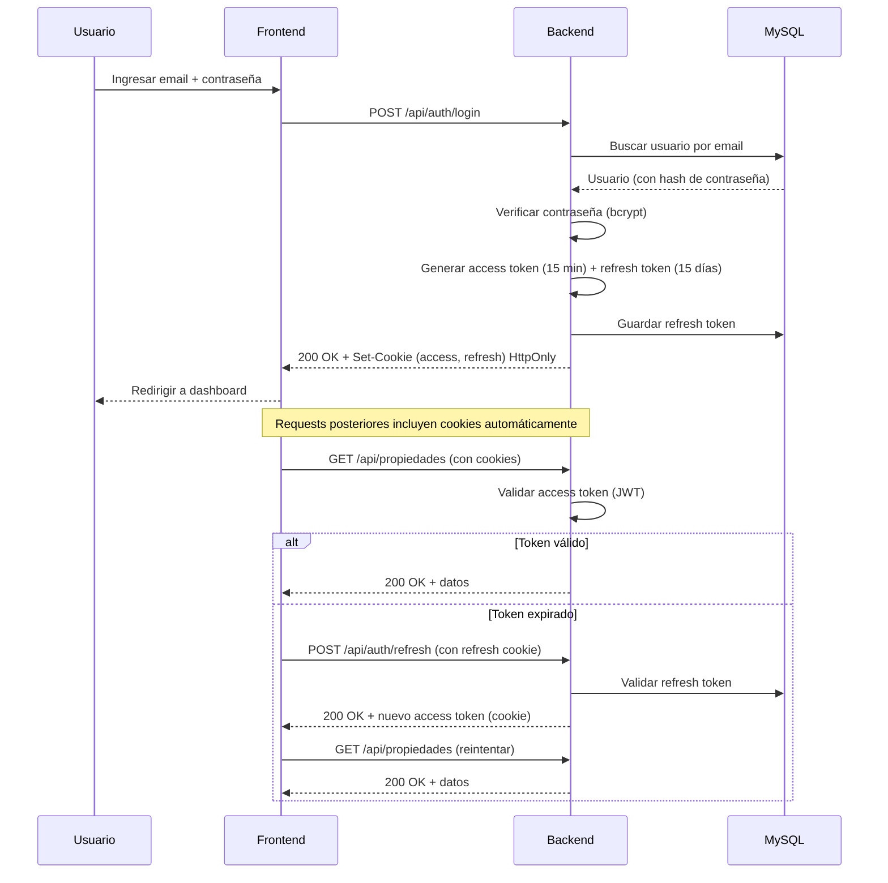
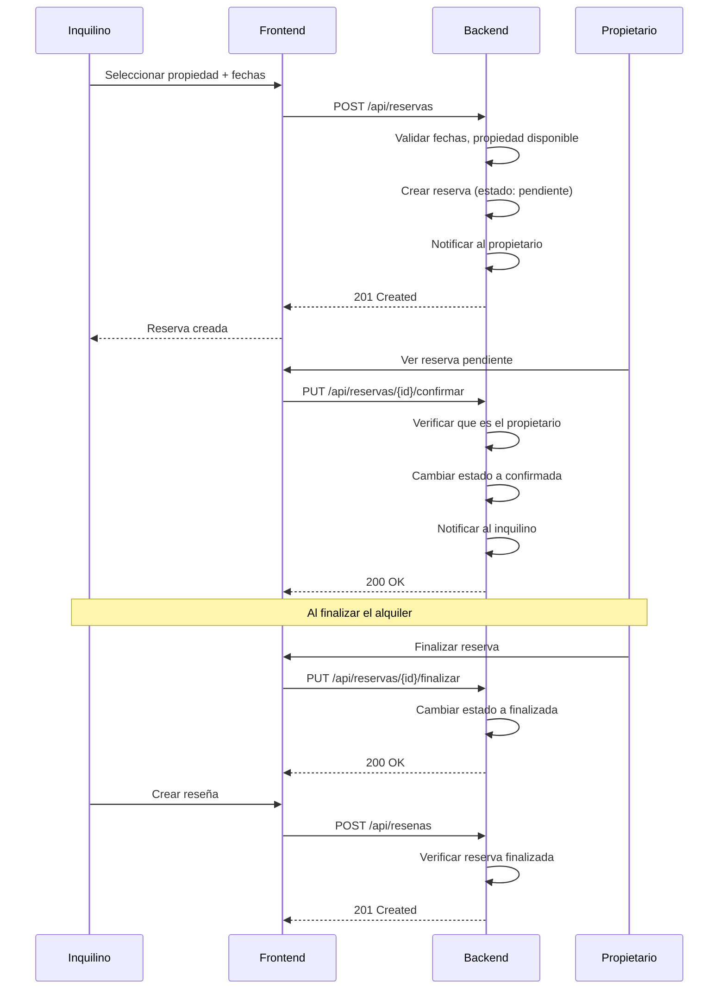
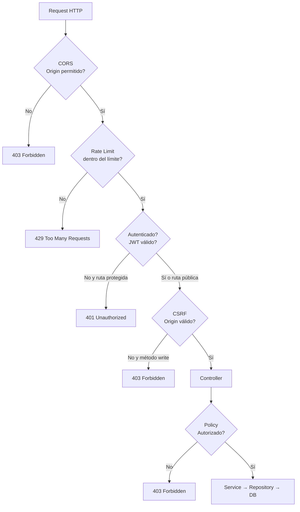
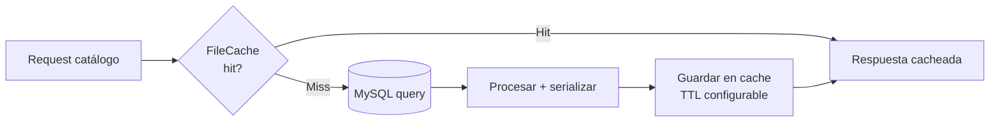

# Arquitectura del Sistema — AlquilER

> Documento de arquitectura: componentes, capas, flujos y despliegue del sistema AlquilER.

## 1. Visión general

AlquilER es un sistema de alquiler de propiedades con arquitectura **cliente-servidor**:

- **Frontend**: SPA en React + Vite (TypeScript), servida como sitio estático.
- **Backend**: API REST en PHP 8.2 (sin framework, arquitectura en capas), corriendo sobre Apache/Nginx + MySQL 8.
- **Comunicación**: HTTP/JSON con cookies HttpOnly para autenticación.

## 2. Diagrama de arquitectura de alto nivel



## 3. Arquitectura en capas del backend

El backend sigue el patrón **Controller → Service → Repository → Model**:



### Responsabilidades por capa

| Capa | Responsabilidad |
|---|---|
| **Routes** | Mapeo de URLs a controladores y middlewares. |
| **Middlewares** | Autenticación (JWT), CSRF (Origin), CORS, rate limiting, logging. |
| **Controllers** | Recibir request, validar entrada, llamar al servicio, formatear respuesta HTTP. |
| **Validators** | Validación de campos (formato, tipo, rangos, obligatoriedad). |
| **Services** | Lógica de negocio, orquestación, reglas de dominio. |
| **Policies** | Autorización (¿puede este usuario hacer esta acción?). |
| **Repositories** | Acceso a datos (queries, persistencia). |
| **Models** | Entidades de dominio (Eloquent ORM). |

## 4. Estructura de directorios del backend

```
AlquilER/
├── public/
│   ├── index.php          # Front controller
│   ├── router-dev.php     # Router para PHP built-in server
│   └── .htaccess          # Rewrite rules
├── src/
│   ├── Cache/             # FileCache
│   ├── Controllers/Api/   # Controladores REST
│   ├── Debug/             # Herramientas de debug
│   ├── Docs/              # Documentación interna
│   ├── Exceptions/        # Excepciones personalizadas
│   ├── Helpers/           # Helpers (ResponseHelper, etc.)
│   ├── Http/              # Request/Response
│   ├── Middlewares/       # Middlewares HTTP
│   ├── Models/            # Modelos Eloquent
│   ├── Performance/       # Instrumentación
│   ├── Policies/          # Autorización
│   ├── Repositories/      # Acceso a datos
│   ├── Routes/            # Definición de rutas
│   ├── Sanitizers/        # Sanitización de inputs
│   ├── Security/          # CSRF, rate limiting, headers
│   ├── Services/          # Lógica de negocio
│   └── Validators/        # Validación de campos
├── config/
│   ├── config.php         # Configuración principal
│   └── database.php       # Conexión BD
├── scripts/
│   ├── migrations/        # Migraciones SQL
│   └── seeders/           # Seeders de datos
├── storage/
│   ├── uploads/           # Imágenes subidas
│   ├── cache/             # Cache de catálogos
│   ├── logs/              # Logs de la app
│   └── rate_limit/        # Contadores de rate limit
└── .env                   # Variables de entorno
```

## 5. Arquitectura del frontend



### Estructura de directorios del frontend

```
sistema-alquiler-frontend-web/
├── src/
│   ├── api/               # Llamadas a la API backend
│   ├── components/        # Componentes reutilizables
│   ├── contexts/          # Contextos (Auth, Theme, Toast)
│   ├── hooks/             # Custom hooks
│   ├── pages/             # Páginas (rutas)
│   ├── styles/            # CSS (base, responsive, tokens)
│   ├── types/             # Tipos TypeScript
│   ├── utils/             # Utilidades
│   └── assets/            # Imágenes, iconos
├── public/
│   ├── .htaccess          # SPA fallback + charset
│   └── ...
├── vite.config.ts         # Configuración de Vite
└── package.json
```

## 6. Flujo de autenticación



## 7. Flujo de una reserva



## 8. Despliegue (Deployment)

```mermaid
flowchart TD
    subgraph Producción
        A[alquilerr.alwaysdata.net<br/>Frontend estático] -->|/api/*<|end|> B[alquiler.alwaysdata.net<br/>Backend PHP]
        B --> C[(MySQL alwaysdata)]
        B --> D[storage/<br/>uploads, logs, cache]
    end

    subgraph Desarrollo local
        E[localhost:3000<br/>Vite dev server] -->|proxy /api| F[127.0.0.1:8000<br/>PHP built-in server]
        F --> G[(MySQL local<br/>sistema_alquiler_db)]
    end

    subgraph Repositorios
        H[GitHub: AlquilER-frontend-web] -->|build + deploy| A
        I[GitHub: AlquilER-backend] -->|deploy manual FTP| B
    end
```

## 9. Patrones de diseño utilizados

| Patrón | Dónde | Descripción |
|---|---|---|
| **Repository** | `src/Repositories/` | Abstracción del acceso a datos (interfaces). |
| **Service Layer** | `src/Services/` | Lógica de negocio desacoplada de HTTP. |
| **Middleware** | `src/Middlewares/` | Pipeline de procesamiento de requests. |
| **Policy** | `src/Policies/` | Autorización basada en roles y ownership. |
| **DTO / Validator** | `src/Validators/` | Validación de entrada desacoplada. |
| **Factory** | `src/Helpers/` | Creación de respuestas HTTP estandarizadas. |
| **Singleton** | `config/database.php` | Conexión única a la base de datos. |
| **Observer (notificaciones)** | `src/Services/NotificacionService.php` | Generación automática de notificaciones por eventos. |

## 10. Seguridad en la arquitectura



## 11. Cache y performance



- **FileCache**: cache de catálogos de baja rotación (categorías, provincias, localidades, servicios).
- **Instrumentación**: `PerformanceMiddleware` registra tiempos de respuesta en `storage/logs/performance.jsonl`.
- **Rotación de logs**: 5MB por archivo, 3 generaciones.
- **Eloquent eager loading**: `with()` para evitar N+1 en listados con imágenes y servicios.
