# Arquitectura del Sistema — AlquilER

> Documento de arquitectura: componentes, capas, flujos y despliegue del sistema AlquilER.

## 1. Visión general

AlquilER es un sistema de alquiler de propiedades con arquitectura **cliente-servidor**:

- **Frontend**: SPA en React + Vite (TypeScript), servida como sitio estático.
- **Backend**: API REST en PHP 8.2 (sin framework, arquitectura en capas), corriendo sobre Apache/Nginx + MySQL 8.
- **Comunicación**: HTTP/JSON con cookies HttpOnly para autenticación.

## 2. Diagrama de arquitectura de alto nivel

```mermaid
flowchart LR
    U[Usuario / Navegador] -->|HTTPS| F[Frontend SPA<br/>React + Vite<br/>alquilerr.alwaysdata.net]
    F -->|/api/* JSON + cookies| B[Backend API<br/>PHP 8.2<br/>alquiler.alwaysdata.net]
    B -->|PDO / Eloquent| D[(MySQL 8<br/>sistema_alquiler_db)]
    B -->|SMTP| M[Servidor de email<br/>Resend / SMTP]
    B -->|Filesystem| S[storage/<br/>uploads, logs, cache]
    F -.->|assets estáticos| CDN[CDN / Hosting estático]
```

## 3. Arquitectura en capas del backend

El backend sigue el patrón **Controller → Service → Repository → Model**:


### Responsabilidades por capa

| Capa | Responsabilidad |
|---|---|
| **Routes** | Mapeo de URLs a controladores y middlewares. |
| **Middlewares** | CSRF (Origin/cookies), rate limiting, debug (solo dev). La autenticación JWT la maneja `Authenticator` en `src/Security/`. |
| **Controllers** | Recibir request, validar entrada, llamar al servicio, formatear respuesta HTTP. |
| **Validators** | Validación de campos (formato, tipo, rangos, obligatoriedad). |
| **Services** | Lógica de negocio, orquestación, reglas de dominio. |
| **Policies** | Autorización (¿puede este usuario hacer esta acción?). |
| **Repositories** | Acceso a datos (queries, persistencia). |
| **Models** | Entidades de dominio (Eloquent ORM). |

## 4. Estructura de directorios del backend

```
AlquilER/
├── public/
│   ├── index.php          # Front controller
│   ├── router-dev.php     # Router para PHP built-in server
│   └── .htaccess          # Rewrite rules
├── src/
│   ├── Cache/             # FileCache
│   ├── Controllers/Api/   # Controladores REST
│   ├── Debug/             # Herramientas de debug
│   ├── Docs/              # Documentación interna
│   ├── Exceptions/        # Excepciones personalizadas
│   ├── Helpers/           # Helpers (ResponseHelper, etc.)
│   ├── Http/              # Request/Response
│   ├── Middlewares/       # Middlewares HTTP
│   ├── Models/            # Modelos Eloquent
│   ├── Performance/       # Instrumentación
│   ├── Policies/          # Autorización
│   ├── Repositories/      # Acceso a datos
│   ├── Routes/            # Definición de rutas
│   ├── Sanitizers/        # Sanitización de inputs
│   ├── Security/          # CSRF, rate limiting, headers
│   ├── Services/          # Lógica de negocio
│   └── Validators/        # Validación de campos
├── config/
│   ├── config.php         # Configuración principal
│   └── database.php       # Conexión BD
├── scripts/
│   ├── migrations/        # Migraciones SQL
│   └── seeders/           # Seeders de datos
├── storage/
│   ├── uploads/           # Imágenes subidas
│   ├── cache/             # Cache de catálogos
│   ├── logs/              # Logs de la app
│   └── rate_limit/        # Contadores de rate limit
└── .env                   # Variables de entorno
```

## 5. Arquitectura del frontend

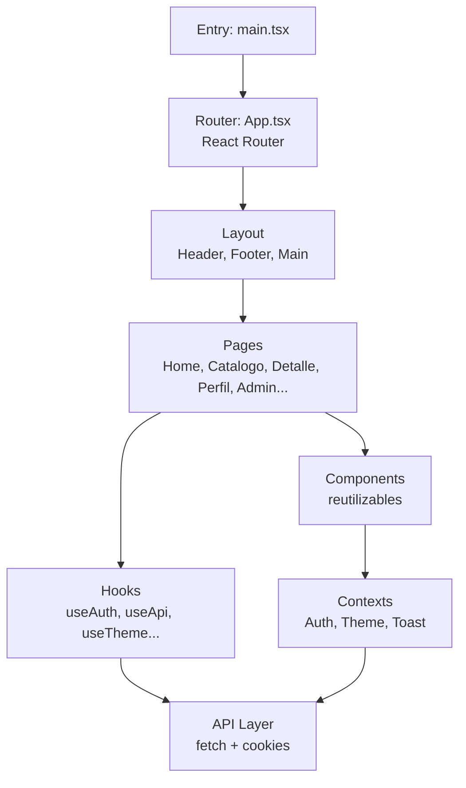

### Estructura de directorios del frontend

```
sistema-alquiler-frontend-web/
├── src/
│   ├── api/               # Llamadas a la API backend
│   ├── components/        # Componentes reutilizables
│   ├── contexts/          # Contextos (Auth, Theme, Toast)
│   ├── hooks/             # Custom hooks
│   ├── pages/             # Páginas (rutas)
│   ├── styles/            # CSS (base, responsive, tokens)
│   ├── types/             # Tipos TypeScript
│   ├── utils/             # Utilidades
│   └── assets/            # Imágenes, iconos
├── public/
│   ├── .htaccess          # SPA fallback + charset
│   └── ...
├── vite.config.ts         # Configuración de Vite
└── package.json
```

## 6. Flujo de autenticación

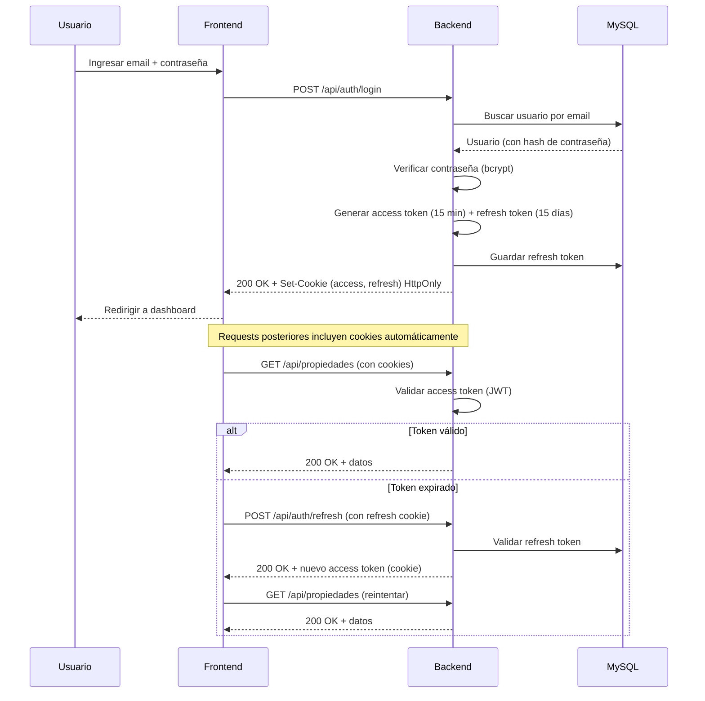

## 7. Flujo de una reserva

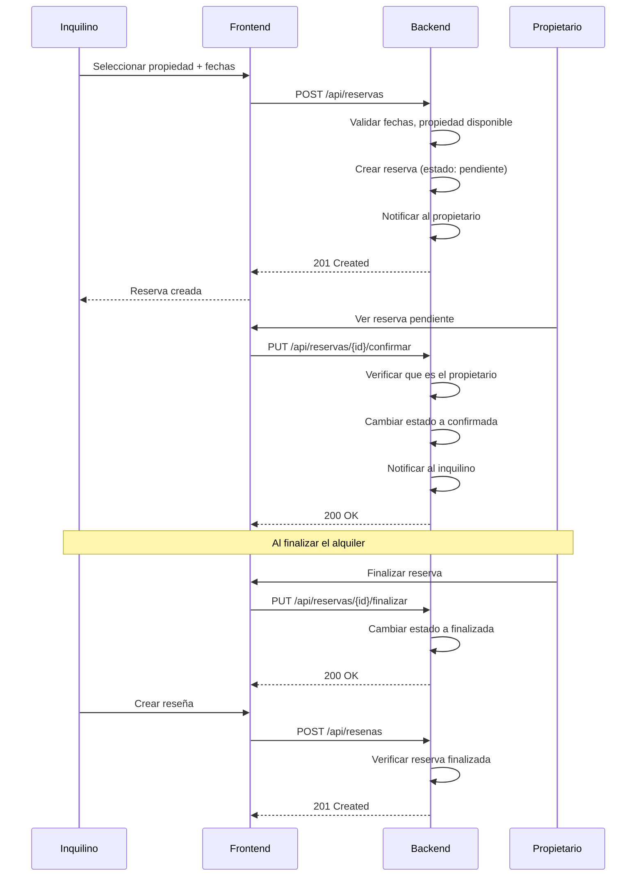

## 8. Despliegue (Deployment)

```mermaid
flowchart TD
    subgraph Producción
        A[alquilerr.alwaysdata.net<br/>Frontend estático] -->|/api/*<|end|> B[alquiler.alwaysdata.net<br/>Backend PHP]
        B --> C[(MySQL alwaysdata)]
        B --> D[storage/<br/>uploads, logs, cache]
    end

    subgraph Desarrollo local
        E[localhost:3000<br/>Vite dev server] -->|proxy /api| F[127.0.0.1:8000<br/>PHP built-in server]
        F --> G[(MySQL local<br/>sistema_alquiler_db)]
    end

    subgraph Repositorios
        H[GitHub: AlquilER-frontend-web] -->|build + deploy| A
        I[GitHub: AlquilER-backend] -->|deploy manual FTP| B
    end
```

## 9. Patrones de diseño utilizados

| Patrón | Dónde | Descripción |
|---|---|---|
| **Repository** | `src/Repositories/` | Abstracción del acceso a datos (interfaces). |
| **Service Layer** | `src/Services/` | Lógica de negocio desacoplada de HTTP. |
| **Middleware** | `src/Middlewares/` | Pipeline de procesamiento de requests. |
| **Policy** | `src/Policies/` | Autorización basada en roles y ownership. |
| **DTO / Validator** | `src/Validators/` | Validación de entrada desacoplada. |
| **Factory** | `src/Helpers/` | Creación de respuestas HTTP estandarizadas. |
| **Singleton** | `config/database.php` | Conexión única a la base de datos. |
| **Observer (notificaciones)** | `src/Services/NotificacionService.php` | Generación automática de notificaciones por eventos. |

## 10. Seguridad en la arquitectura

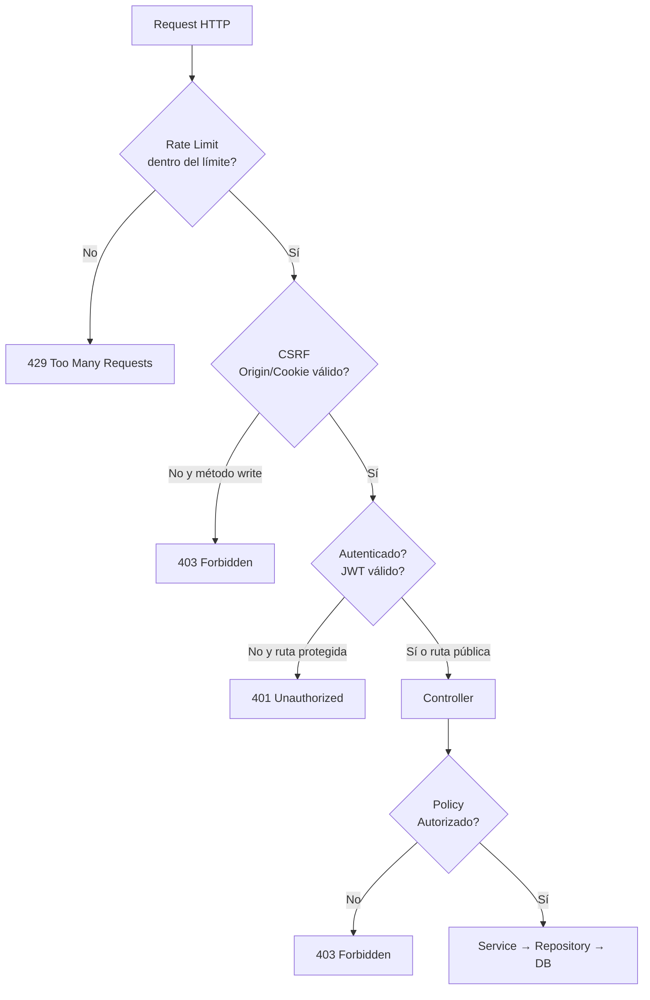

## 11. Cache y performance

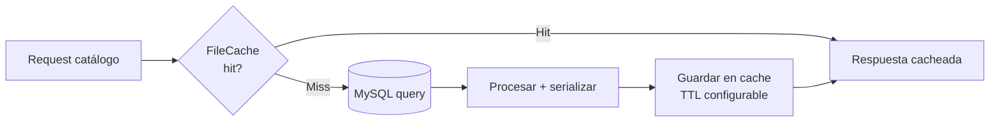

- **FileCache**: cache de catálogos de baja rotación (categorías, provincias, localidades, servicios).
- **Instrumentación**: `PerformanceMiddleware` registra tiempos de respuesta en `storage/logs/performance.jsonl`.
- **Rotación de logs**: 5MB por archivo, 3 generaciones.
- **Eloquent eager loading**: `with()` para evitar N+1 en listados con imágenes y servicios.

---

## 12. Máquina de estados: Reservas

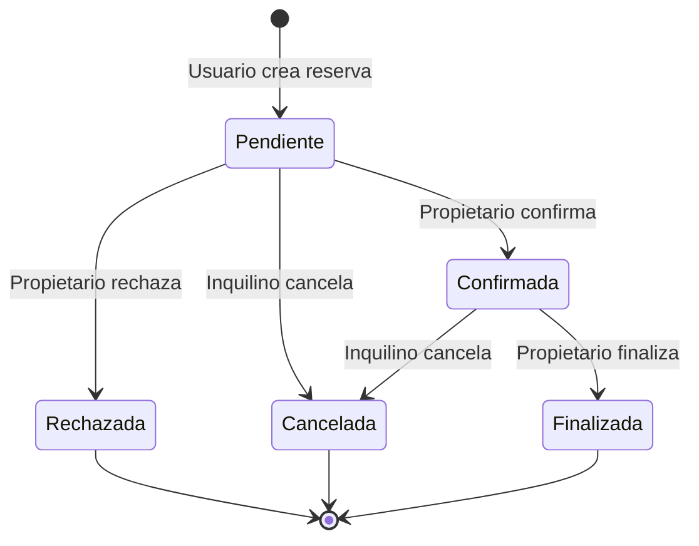

### Transiciones válidas

| Estado actual | Acción | Nuevo estado | Quién ejecuta |
|---|---|---|---|
| Pendiente | Confirmar | Confirmada | Propietario |
| Pendiente | Rechazar | Rechazada | Propietario |
| Pendiente | Cancelar | Cancelada | Inquilino |
| Confirmada | Finalizar | Finalizada | Propietario |
| Confirmada | Cancelar | Cancelada | Inquilino |

> Cada transición genera una notificación al inquilino.

## 13. Flujo de publicación de propiedad

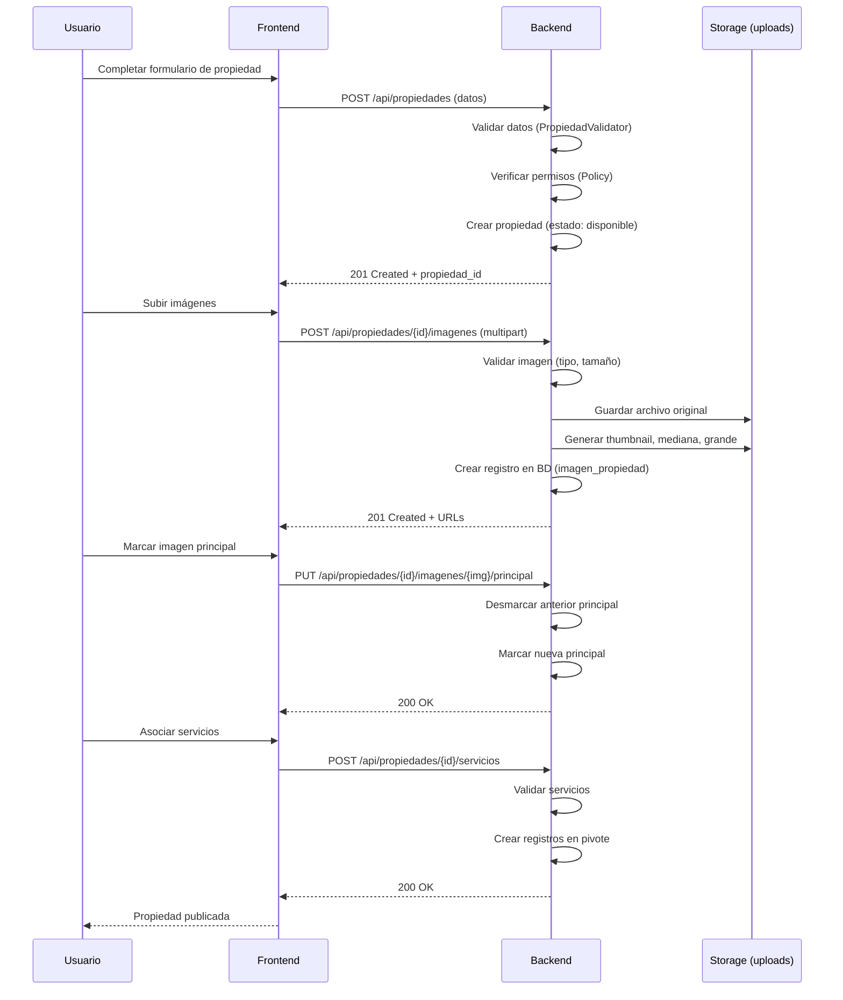

## 14. Flujo de notificaciones

```mermaid
flowchart TD
    E[Evento del sistema] --> D{Tipo de evento}
    D -->|Nueva reserva| N1[Notificar al propietario]
    D -->|Reserva confirmada/rechazada/cancelada/finalizada| N2[Notificar al inquilino]
    D -->|Nueva consulta| N3[Notificar al propietario]
    D -->|Respuesta a consulta| N4[Notificar al interesado]
    D -->|Nueva reseña| N5[Notificar al reseñado]
    N1 --> S[NotificacionService::crear()]
    N2 --> S
    N3 --> S
    N4 --> S
    N5 --> S
    S --> DB[(Tabla notificaciones)]
    S --> C[Incrementar contador no leídas]
    DB --> F[Frontend consulta notificaciones]
    F --> U[Usuario ve notificación]
```

## 15. Pipeline de despliegue

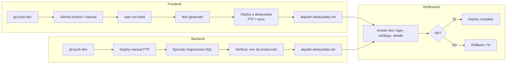

## 16. Diagrama de componentes del frontend (detalle)

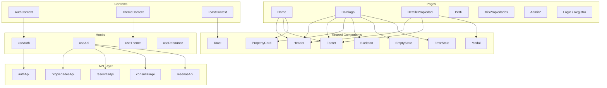

---

## 17. Diagrama de flujo de datos (DFD) — Nivel 1

```mermaid
flowchart LR
    U[Usuario] -->|Credenciales, datos de propiedad, reservas| F[Frontend SPA]
    F -->|JSON + cookies| B[Backend API]
    B -->|Queries SQL| D[(MySQL)]
    B -->|Archivos| S[Storage<br/>uploads, logs, cache]
    B -->|Emails<|end|> M[Servidor SMTP]
    D -->|Datos| B
    S -->|Archivos| B
    M -->|Confirmación| B
    B -->|JSON responses| F
    F -->|HTML/CSS/JS<|end|> U
```

### Flujos de datos principales

| Flujo | Origen | Destino | Datos |
|---|---|---|---|
| Autenticación | Usuario → Frontend → Backend → BD | Tokens en cookies | email, contraseña |
| Publicación de propiedad | Usuario → Frontend → Backend → BD + Storage | Propiedad + imágenes | título, precio, fotos, servicios |
| Reserva | Inquilino → Frontend → Backend → BD | Reserva + notificación | fechas, propiedad_id |
| Búsqueda | Usuario → Frontend → Backend → BD (cache) | Listado paginado | filtros, orden, página |
| Consulta | Usuario → Frontend → Backend → BD | Consulta + notificación | mensaje, propiedad_id |
| Reseña | Usuario → Frontend → Backend → BD | Reseña + notificación | calificación, comentario |

## 18. Pipeline de procesamiento de imágenes

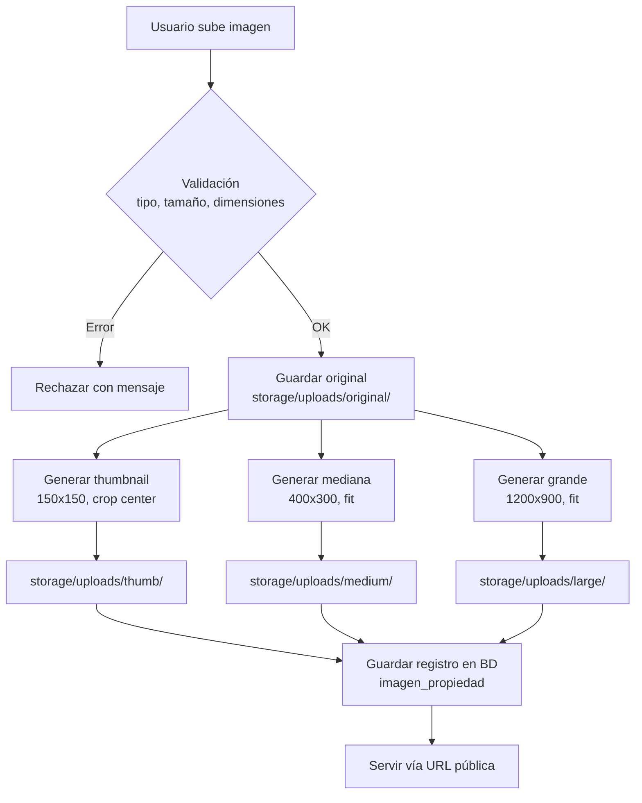

### Formatos y tamaños soportados

| Tamaño | Dimensiones | Uso |
|---|---|---|
| Thumbnail | 150×150 | Listados, carruseles |
| Mediana | 400×300 | Cards de catálogo |
| Grande | 1200×900 | Detalle de propiedad |
| Original | Sin modificar | Backup, descarga |

## 19. Flujo de manejo de errores

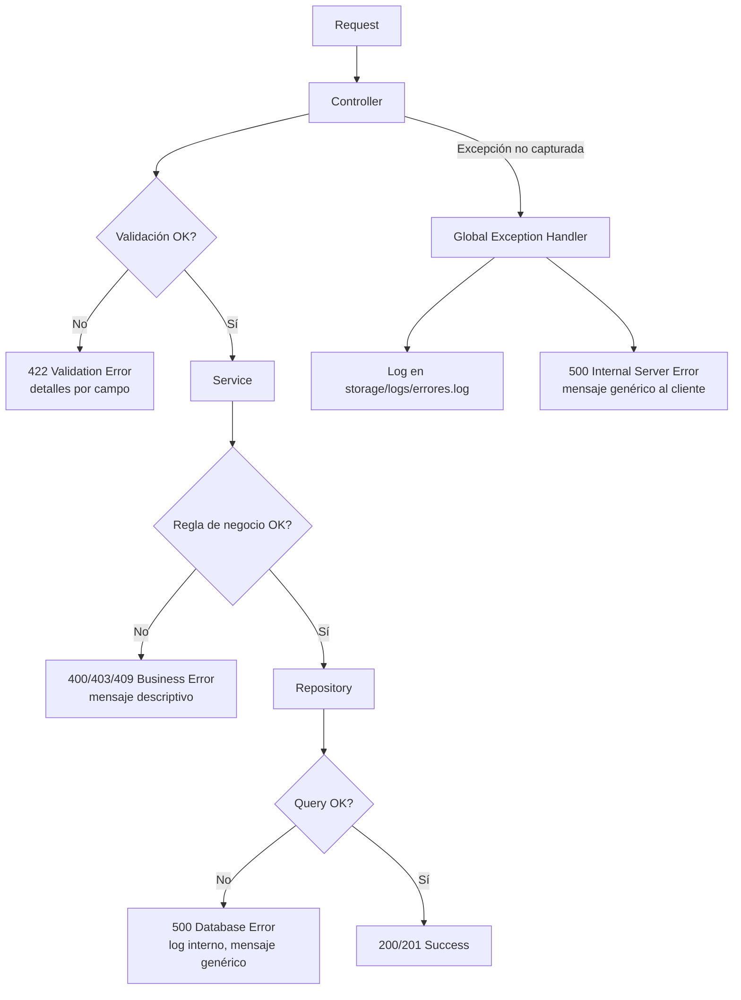

### Tipos de error y códigos HTTP

| Código | Tipo | Cuándo |
|---|---|---|
| 400 | Bad Request | Datos malformados |
| 401 | Unauthorized | No autenticado o token inválido |
| 403 | Forbidden | Autenticado pero sin permisos |
| 404 | Not Found | Recurso no existe |
| 409 | Conflict | Conflicto de estado (ej: email duplicado) |
| 422 | Unprocessable Entity | Validación de campos fallida |
| 429 | Too Many Requests | Rate limit excedido |
| 500 | Internal Server Error | Error inesperado del servidor |

## 20. Modelo de dominio (Class Diagram)

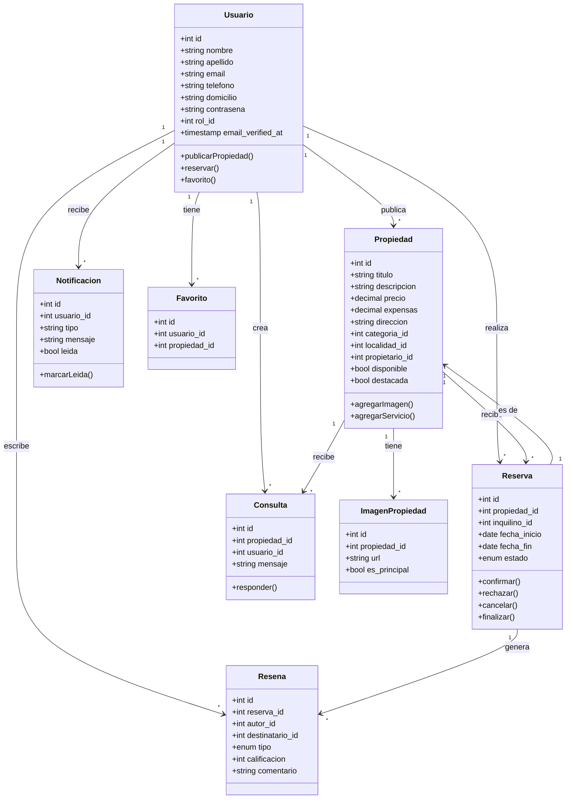

---

## 21. Matriz de roles y permisos (RBAC)

```mermaid
flowchart TD
    subgraph Visitante["Visitante (no autenticado)"]
        V1[Ver catálogo de propiedades]
        V2[Ver detalle de propiedad]
        V3[Ver servicios, categorías]
        V4[Enviar mensaje de contacto]
        V5[Ver FAQ]
    end

    subgraph Usuario["Usuario (rol_id=1)"]
        U1[Todo lo del Visitante]
        U2[Registrarse y verificar email]
        U3[Iniciar/cerrar sesión]
        U4[Publicar propiedades]
        U5[Reservar propiedades]
        U6[Agregar/quitar favoritos]
        U7[Consultar sobre propiedades]
        U8[Responder consultas (si es propietario)]
        U9[Crear reseñas (post-reserva finalizada)]
        U10[Editar perfil y contraseña]
        U11[Ver notificaciones]
    end

    subgraph Propietario["Propietario (implícito)"]
        P1[Todo lo del Usuario]
        P2[Editar/eliminar sus propiedades]
        P3[Confirmar/rechazar reservas]
        P4[Finalizar reservas]
        P5[Responder consultas de sus propiedades]
        P6[Reseñar inquilinos]
        P7[Marcar imagen principal]
    end

    subgraph Admin["Administrador (rol_id=2)"]
        A1[Todo lo del Usuario]
        A2[Panel de administración]
        A3[Gestionar usuarios (CRUD + restore)]
        A4[Gestionar categorías, provincias, localidades, servicios, roles]
        A5[Gestionar propiedades (todas, incluyendo eliminadas)]
        A6[Marcar propiedades como destacadas]
        A7[Gestionar reservas, consultas, reseñas]
        A8[Ver y restaurar registros eliminados (papelera)]
        A9[Ver logs de actividad]
        A10[Restaurar registros soft-deleted]
    end
```

### Tabla de permisos por recurso

| Recurso | Visitante | Usuario | Propietario | Admin |
|---|---|---|---|---|
| Ver catálogo | ✅ | ✅ | ✅ | ✅ |
| Ver detalle propiedad | ✅ | ✅ | ✅ | ✅ |
| Publicar propiedad | ❌ | ✅ | ✅ | ✅ |
| Editar propiedad propia | ❌ | ❌ | ✅ | ✅ |
| Editar propiedad ajena | ❌ | ❌ | ❌ | ✅ |
| Reservar | ❌ | ✅ | ✅ | ✅ |
| Confirmar/rechazar reserva | ❌ | ❌ | ✅ (suya) | ✅ |
| Cancelar reserva | ❌ | ✅ (propia) | ✅ (propia) | ✅ |
| Finalizar reserva | ❌ | ❌ | ✅ (suya) | ✅ |
| Favoritos | ❌ | ✅ | ✅ | ✅ |
| Consultas | ❌ | ✅ | ✅ | ✅ |
| Reseñas | ❌ | ✅ (post-finalizada) | ✅ | ✅ |
| Panel admin | ❌ | ❌ | ❌ | ✅ |
| Papelera (restore) | ❌ | ❌ | ❌ | ✅ |
| Logs de actividad | ❌ | ❌ | ❌ | ✅ |

## 22. Flujo de búsqueda y filtrado

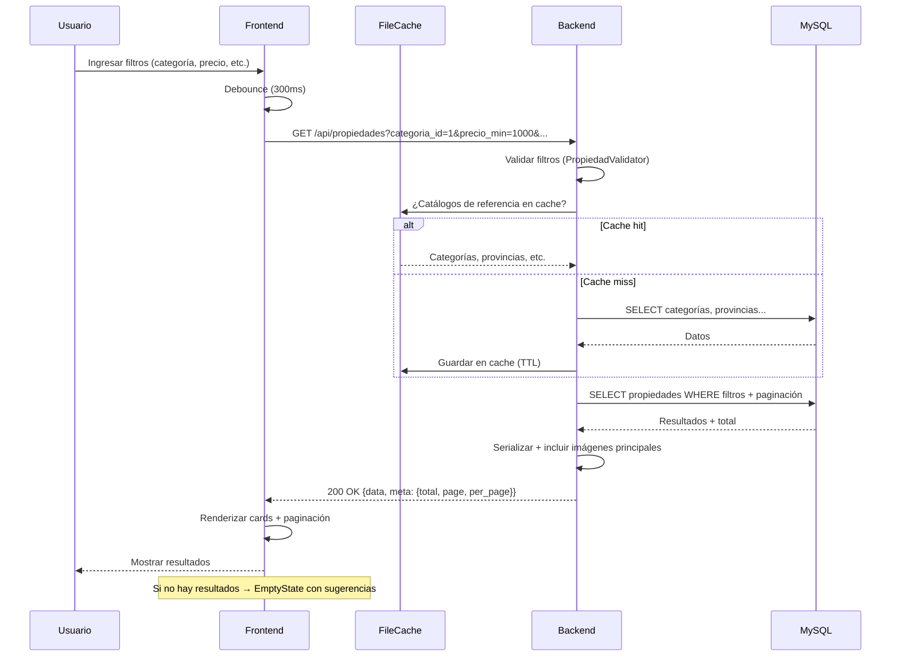

### Filtros disponibles

| Filtro | Tipo | Descripción |
|---|---|---|
| `categoria_id` | int[] | Categorías (múltiples) |
| `provincia_id` | int | Provincia |
| `localidad_id` | int | Localidad |
| `servicio_id` | int[] | Servicios (múltiples) |
| `acepta_mascotas` | bool | Acepta mascotas |
| `acepta_hijos` | bool | Acepta hijos |
| `precio_min` / `precio_max` | decimal | Rango de precio |
| `cantidad_ambientes` | int | Ambientes |
| `cantidad_dormitorios` | int | Dormitorios |
| `cantidad_banos` | int | Baños |
| `capacidad` | int | Capacidad de personas |
| `page` | int | Página (default: 1) |
| `per_page` | int | Resultados por página (default: 10) |
| `orden` | string | Ordenamiento (recientes, precio_asc, precio_desc) |

## 23. Flujo de consultas y mensajería

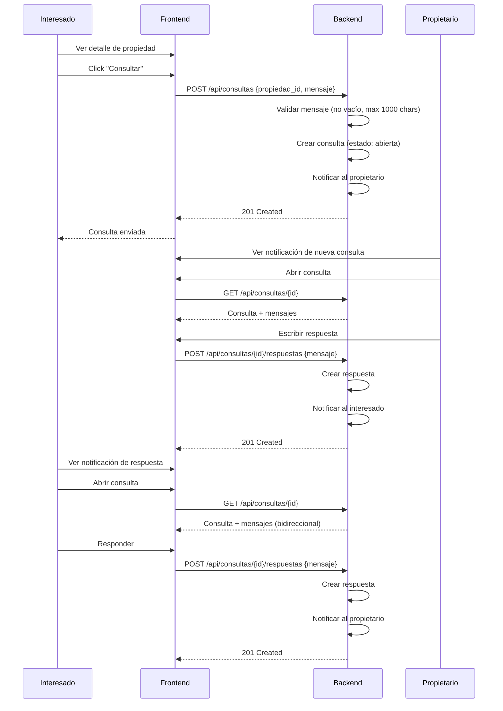

### Reglas de la mensajería

| Regla | Descripción |
|---|---|
| RN-35 | Solo usuarios autenticados pueden consultar. |
| RN-36 | Solo el propietario de la propiedad puede responder. |
| RN-37 | La mensajería es bidireccional (interesado ↔ propietario). |
| RN-38 | Al crear consulta, se notifica al propietario. |
| RN-39 | Al responder, se notifica al interesado. |
| RN-40 | Las consultas usan soft delete. |

## 24. Topología de red e infraestructura

```mermaid
flowchart TD
    subgraph Internet
        DNS[DNS: alquilerr.alwaysdata.net<br/>alquiler.alwaysdata.net]
    end

    subgraph alwaysdata["alwaysdata (Hosting compartido)"]
        subgraph Frontend["Servidor Frontend"]
            Apache1[Apache<br/>Sirve archivos estáticos]
            HT1[.htaccess<br/>SPA fallback + UTF-8]
        end
        subgraph Backend["Servidor Backend"]
            Apache2[Apache + mod_php<br/>PHP 8.2]
            HT2[.htaccess<br/>Rewrite + headers]
            PHP[PHP App<br/>src/ + config/]
            Storage[storage/<br/>uploads, logs, cache]
        end
        subgraph Database["Base de datos"]
            MySQL[(MySQL 8.0<br/>sistema_alquiler_db)]
        end
    end

    subgraph Externo["Servicios externos"]
        Resend[Resend / SMTP<br/>Envío de emails]
        CDN[CDN (opcional)<br/>Assets estáticos]
    end

    DNS --> Apache1
    DNS --> Apache2
    Apache1 --> HT1
    Apache2 --> HT2
    HT2 --> PHP
    PHP --> Storage
    PHP --> MySQL
    PHP --> Resend
    Apache1 -.-> CDN
```

### Puertos y protocolos

| Servicio | Puerto | Protocolo | Descripción |
|---|---|---|---|
| Frontend (producción) | 443 | HTTPS | Sitio estático (React build) |
| Backend (producción) | 443 | HTTPS | API REST (PHP) |
| MySQL (producción) | 3306 | TCP | Base de datos (interna) |
| Frontend (desarrollo) | 3000 | HTTP | Vite dev server |
| Backend (desarrollo) | 8000 | HTTP | PHP built-in server |
| MySQL (desarrollo) | 3306 | TCP | MySQL local |

### Variables de entorno por entorno

| Variable | Desarrollo | Producción |
|---|---|---|
| `APP_ENV` | `development` | `production` |
| `APP_URL` | `http://localhost:3000` | `https://alquilerr.alwaysdata.net` |
| `API_URL` | `http://127.0.0.1:8000` | `https://alquiler.alwaysdata.net` |
| `DB_HOST` | `127.0.0.1` | `mysql-alquiler.alwaysdata.net` |
| `MAIL_HOST` | (vacío = log local) | `smtp.resend.com` |
| `CORS_ALLOWED_ORIGINS` | `http://localhost:3000` | `https://alquilerr.alwaysdata.net` |
