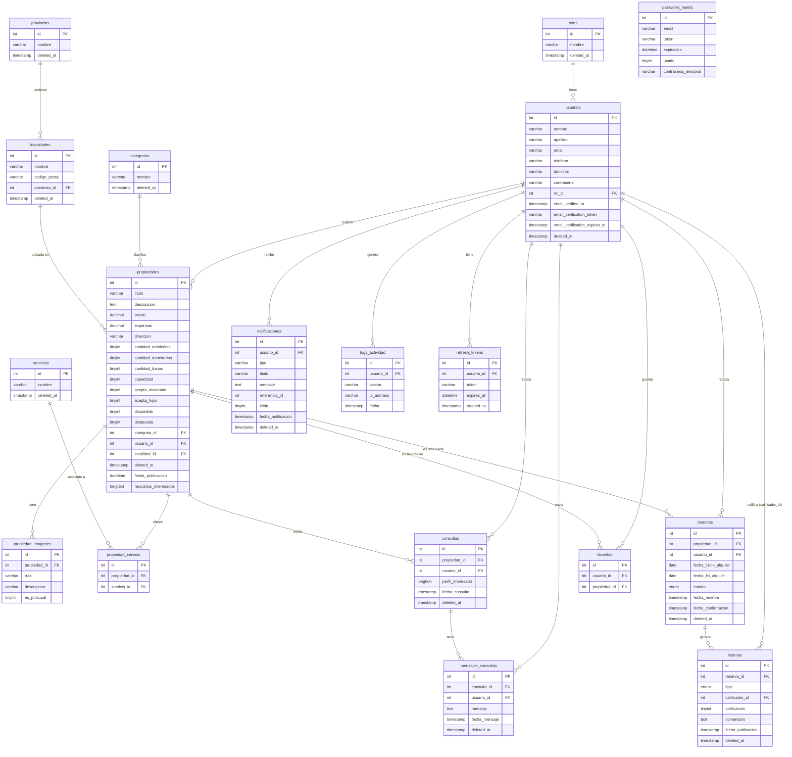

# Diagrama Entidad-Relación — AlquilER

> Generado a partir del esquema de la base de datos `sistema_alquiler_db`.

## Diagrama (Mermaid)

## Relaciones principales

| Entidad A | Relación | Entidad B | Descripción |
|---|---|---|---|
| `roles` | 1:N | `usuarios` | Un rol tiene muchos usuarios |
| `usuarios` | 1:N | `propiedades` | Un usuario publica muchas propiedades |
| `usuarios` | 1:N | `reservas` | Un usuario (inquilino) realiza reservas |
| `usuarios` | 1:N | `consultas` | Un usuario realiza consultas |
| `usuarios` | 1:N | `favoritos` | Un usuario guarda favoritos |
| `usuarios` | 1:N | `notificaciones` | Un usuario recibe notificaciones |
| `usuarios` | 1:N | `logs_actividad` | Un usuario genera logs |
| `usuarios` | 1:N | `refresh_tokens` | Un usuario tiene refresh tokens |
| `usuarios` | 1:N | `mensajes_consultas` | Un usuario envía mensajes |
| `usuarios` | 1:N | `resenas` | Un usuario califica (calificador_id) |
| `categorias` | 1:N | `propiedades` | Una categoría clasifica propiedades |
| `provincias` | 1:N | `localidades` | Una provincia contiene localidades |
| `localidades` | 1:N | `propiedades` | Una localidad tiene propiedades |
| `propiedades` | 1:N | `propiedad_imagenes` | Una propiedad tiene imágenes |
| `propiedades` | N:M | `servicios` (via `propiedad_servicio`) | Propiedades ofrecen servicios |
| `propiedades` | 1:N | `reservas` | Una propiedad es reservada |
| `propiedades` | 1:N | `consultas` | Una propiedad recibe consultas |
| `propiedades` | 1:N | `favoritos` | Una propiedad es favorita |
| `reservas` | 1:N | `resenas` | Una reserva genera reseñas |
| `consultas` | 1:N | `mensajes_consultas` | Una consulta tiene mensajes |

## Notas

- Todas las tablas principales usan **soft delete** (`deleted_at` nullable) excepto `favoritos`, `password_resets`, `refresh_tokens`, `propiedad_servicio` y `mensajes_consultas` (estas últimas también tienen `deleted_at`).
- `resenas.tipo` es un enum: `'propiedad'` (reseña de la propiedad por el inquilino) o `'inquilino'` (reseña del inquilino por el propietario).
- `propiedad_servicio` es una tabla pivote N:M entre `propiedades` y `servicios`.
- `favoritos` es una tabla N:M entre `usuarios` y `propiedades`.
- `notificaciones.referencia_id` es una referencia polimórfica (puede apuntar a reservas, consultas, etc. según el `tipo`).
- `password_resets` y `refresh_tokens` no tienen FK a `usuarios` (se vinculan por email/usuario_id respectivamente, pero sin constraint).
- `logs_actividad` registra acciones de usuarios (login, registro, etc.) con IP y timestamp.
