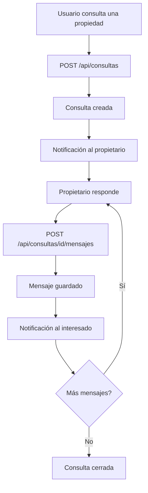
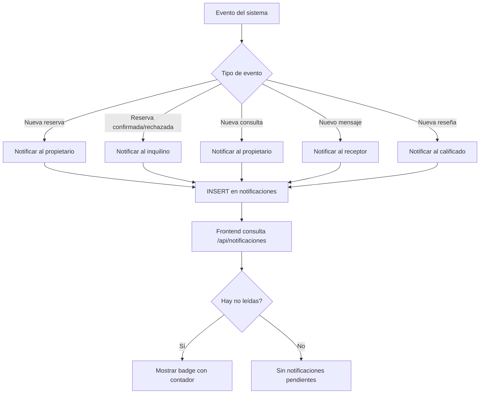

# Mapa de Procesos — AlquilER

> Diagramas de flujo de los procesos de negocio principales del sistema.

## 1. Registro y verificación de email

```mermaid
flowchart TD
    A[Usuario ingresa datos de registro] --> B{Validación de campos}
    B -->|Error| C[Mostrar errores de validación]
    B -->|OK| D{Email ya existe?}
    D -->|Sí| E[Error: usuario ya existe]
    D -->|No| F[Crear usuario con rol Usuario]
    F --> G[Generar token de verificación (60 min)]
    G --> H[Enviar email con enlace de verificación]
    H --> I{SMTP configurado?}
    I -->|No| J[Error visible: email no enviado]
    I -->|Sí| K[Email enviado al usuario]
    K --> L[Usuario hace clic en enlace]
    L --> M{Token válido y no expirado?}
    M -->|No| N[Error: token inválido/expirado]
    M -->|Sí| O[Marcar email como verificado]
    O --> P[Usuario puede iniciar sesión]
```

## 2. Inicio de sesión (Login)

```mermaid
flowchart TD
    A[Usuario ingresa email y contraseña] --> B{Campos válidos?}
    B -->|No| C[Mostrar errores de validación]
    B -->|Sí| D{Usuario existe?}
    D -->|No| E[Error: credenciales inválidas]
    D -->|Sí| F{Contraseña correcta?}
    F -->|No| E
    F -->|Sí| G{Email verificado?}
    G -->|No| H[Error: email no verificado]
    G -->|Sí| I[Generar access token (15 min) y refresh token (15 días)]
    I --> J[Establecer cookies HttpOnly (access_token, refresh_token)]
    J --> K[Registrar log de actividad]
    K --> L[Redirigir a /dashboard]
```

## 3. Búsqueda y reserva de propiedad

```mermaid
flowchart TD
    A[Usuario busca propiedades] --> B[Filtros: categoría, provincia, localidad, servicios, mascotas, hijos, precio, ambientes, etc.]
    B --> C[GET /api/propiedades con filtros]
    C --> D[Mostrar resultados paginados]
    D --> E[Usuario selecciona una propiedad]
    E --> F[Ver detalle de propiedad]
    F --> G{Usuario autenticado?}
    G -->|No| H[Redirigir a /login]
    G -->|Sí| I[Crear reserva]
    I --> J[POST /api/reservas]
    J --> K[Reserva creada (estado: pendiente)]
    K --> L[Notificación al propietario]
    L --> M[Propietario revisa la reserva]
    M --> N{¿Acepta?}
    N -->|Sí| O[Confirmar reserva]
    N -->|No| P[Rechazar reserva]
    O --> Q[Estado: confirmada]
    P --> R[Estado: rechazada]
    Q --> S[Al finalizar: estado finalizada]
    S --> T[Posibilidad de dejar reseña]
```

## 4. Gestión de consultas



## 5. Publicación de propiedad

```mermaid
flowchart TD
    A[Usuario (propietario) crea propiedad] --> B[Completar formulario: título, descripción, precio, dirección, etc.]
    B --> C[POST /api/propiedades]
    C --> D{Validación OK?}
    D -->|No| E[Mostrar errores de validación]
    D -->|Sí| F[Propiedad creada (disponible)]
    F --> G[Subir imágenes]
    G --> H[POST /api/propiedad-imagenes]
    H --> I[Asociar servicios]
    I --> J[POST /api/propiedades/id/servicios]
    J --> K[Propiedad publicada y visible en catálogo]
```

## 6. Reseñas

```mermaid
flowchart TD
    A[Reserva finalizada] --> B{¿Quién califica?}
    B -->|Inquilino| C[Califica la propiedad]
    B -->|Propietario| D[Califica al inquilino]
    C --> E[POST /api/resenas (tipo: propiedad)]
    D --> F[POST /api/resenas (tipo: inquilino)]
    E --> G[Reseña de propiedad visible en detalle]
    F --> H[Reseña de inquilino visible en perfil]
    G --> I[Notificación al propietario]
    H --> J[Notificación al inquilino]
```

## 7. Recuperación de contraseña

```mermaid
flowchart TD
    A[Usuario solicita recuperación] --> B[POST /api/autenticador/recuperar]
    B --> C{Email existe?}
    C -->|No| D[Respuesta genérica (no revelar existencia)]
    C -->|Sí| E[Generar token (30 min)]
    E --> F[Enviar email con enlace de reset]
    F --> G{SMTP configurado?}
    G -->|No| H[Error visible: no se pudo enviar]
    G -->|Sí| I[Email enviado]
    I --> J[Usuario hace clic en enlace]
    J --> K{Token válido y no expirado?}
    K -->|No| L[Error: token inválido/expirado]
    K -->|Sí| M[Usuario ingresa nueva contraseña]
    M --> N[POST /api/autenticador/restablecer]
    N --> O[Contraseña actualizada]
    O --> P[Email de confirmación enviado]
```

## 8. Notificaciones



## 9. Flujo de autenticación (cookies)

```mermaid
flowchart TD
    A[Login: email + contraseña] --> B[Backend valida credenciales]
    B -->|OK| C[Genera access_token (15 min) + refresh_token (15 días)]
    C --> D[Set-Cookie: access_token (path=/, HttpOnly, Secure, SameSite=None)]
    D --> E[Set-Cookie: refresh_token (path=/api/autenticador, HttpOnly, Secure, SameSite=None)]
    E --> F[Frontend recibe respuesta 200]
    F --> G[Requests posteriores envían cookies automáticamente]
    G --> H{¿401 en request?}
    H -->|Sí| I[autoRefresh: POST /api/autenticador/refresh]
    I --> J{Refresh OK?}
    J -->|Sí| K[Reintentar request original]
    J -->|No| L[Disparar auth:session-expired → logout]
    H -->|No| M[Continuar normalmente]
```
